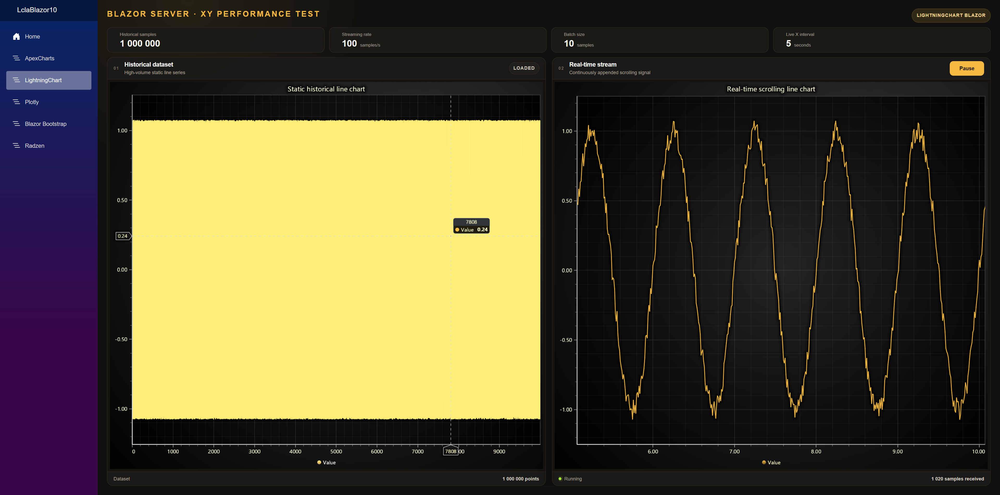

# LightningChart Blazor 10 Charting Library Comparison

This Blazor Server example compares LightningChart, ApexCharts, Plotly, Blazor Bootstrap, and Radzen using historical data loading and real-time streaming. Use the navigation menu to switch between chart libraries and explore their behavior with the same benchmark workload. Each chart page provides controls and metrics for evaluating loading and streaming performance.

Learn more: [LightningChart documentation](https://lightningchart.com/lc-la/docs/)



## Prerequisites

- .NET 10 SDK
- LightningChart JS license key ([get one here](https://lightningchart.com/js-charts/))

## Build and Run
1. Clone the repository:
   ```bash
   git clone https://github.com/Lightning-Chart/lc-la.git
   cd lc-la
   ```
   If you already have the repository, open a terminal in its root folder.

2. Install dependencies:
   ```bash
   npm install
   ```

3. Copy `.env.example` to `.env` in the repository root and set `LCJS_LICENSE_KEY` to your license key.

4. Start the example:
   ```bash
   npm run dev
   ```
   Select "Blazor Server", then "Charting tool comparison".

5. Open https://localhost:5001 (or the URL shown in terminal) and select a chart library from the
   navigation menu.

6. Each library page displays historical data and a real-time chart. Click **Run**
to start streaming and **Pause** to pause it. Use the displayed metrics to
compare loading and streaming performance across the library pages.