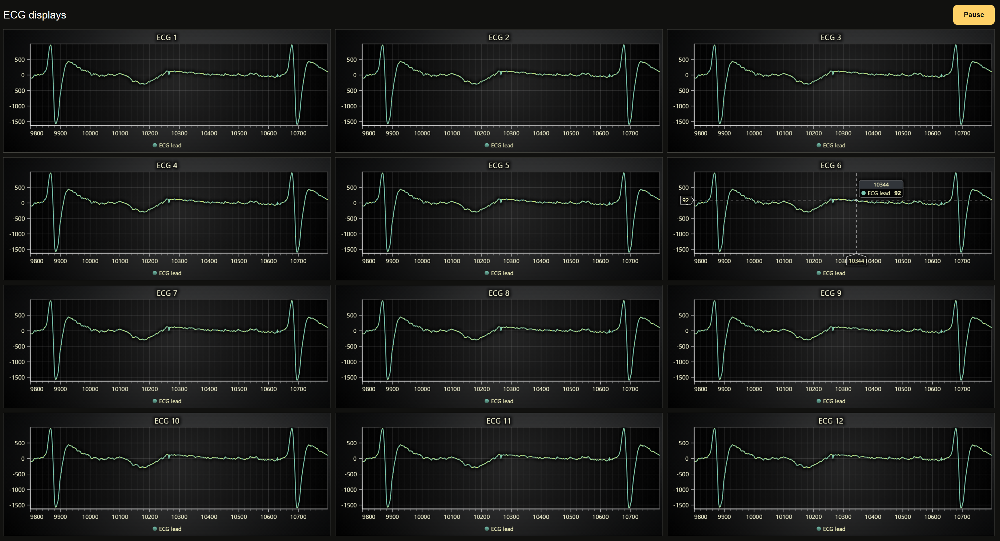

# LightningChart Blazor Server Example

Twelve charts display the same ECG stream from `Data/ecg_1000.csv`. All charts share one dataset, with each streaming batch appended once. Playback loops through the CSV at a target rate of 1,000 samples per second. Each chart shows a one-second scrolling window.

Learn more: [LightningChart documentation](https://lightningchart.com/lc-la/docs/)



## Prerequisites

- .NET 10 SDK
- LightningChart JS license key ([get one here](https://lightningchart.com/js-charts/))

## Build and Run
1. Clone the repository:

   ```bash
   git clone https://github.com/Lightning-Chart/lc-la.git
   cd lc-la
   ```

   If you already have the repository, open a terminal in its root folder.

2. Install dependencies:

   ```bash
   npm install
   ```

3. Copy `.env.example` to `.env` in the repository root and set `LCJS_LICENSE_KEY` to your license key.

4. Start the example runner:

   ```bash
   npm run dev
   ```

   Select "Blazor Server", then "Multiple ECG streams".

5. Open https://localhost:5001 (or the URL shown in terminal) and navigate to "LightningChart Blazor".

6. Click **Play** to start ECG playback and **Pause** to pause it.
   Use the chart's mouse interactions to zoom and pan.