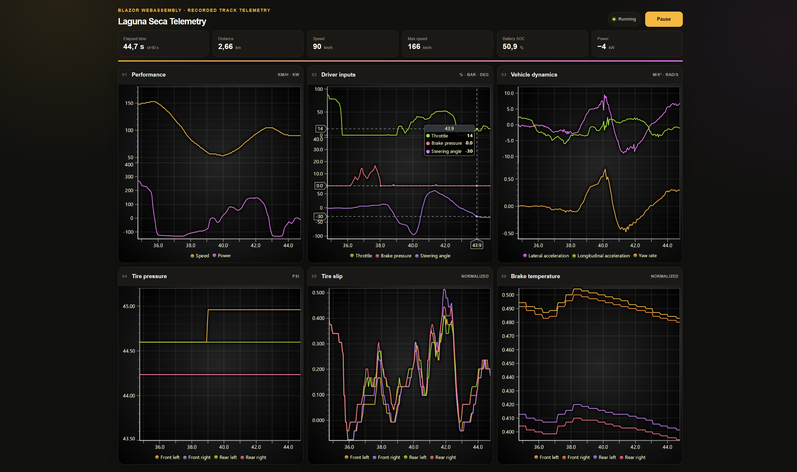

# LightningChart Blazor WebAssembly Example

Six charts replay recorded Laguna Seca vehicle telemetry from `Data/tesla_trackmode_laguna_seca_synced60s.csv`. They all share one telemetry dataset.

Learn more: [LightningChart documentation](https://lightningchart.com/lc-la/docs/)



## Prerequisites

- .NET 10 SDK
- LightningChart JS license key ([get one here](https://lightningchart.com/js-charts/))

## Build and Run

1. Clone the repository:
   ```bash
   git clone https://github.com/Lightning-Chart/lc-la.git
   cd lc-la
   ```

   If you already have the repository, open a terminal in its root folder.

2. Install dependencies:
   ```bash
   npm install
   ```

3. Copy `.env.example` to `.env` in the repository root and set `LCJS_LICENSE_KEY` to your license key.

4. Start the example:
   ```bash
   npm run dev
   ```
   Select "Blazor WebAssembly", then "Vehicle telemetry dashboard".

5. Open the URL shown in the terminal and navigate to "LightningChart Blazor".

6. Click **Run** to replay the recording using its timestamps. Click **Pause** to pause, then **Run** to resume. 
When playback completes, select **Run** to replay from the beginning.