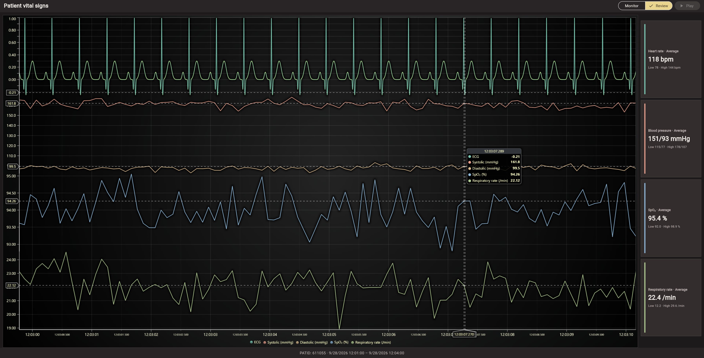

# LightningChart Flutter Example

This Flutter example displays a patient monitoring dashboard with stacked
ECG, blood pressure, oxygen saturation, and respiratory-rate sections.
Systolic and diastolic share an axis. Metric cards show the current
measurements in Monitor mode and recording statistics in Review mode.

Learn more: [LightningChart documentation](https://lightningchart.com/lc-la/docs/)



## Prerequisites

- Flutter 3.44 or newer
- Google Chrome for the web example
- A free LightningChart JS trial key or existing commercial key. Get a trial key [here](https://lightningchart.com/js-charts/).

## Build and Run

1. Clone the repository:
   ```bash
   git clone https://github.com/Lightning-Chart/lc-la.git
   cd lc-la
   ```
   If you already have the repository, open a terminal in its root folder.

2. Install dependencies:
   ```bash
   npm install
   ```

3. Copy `.env.example` to `.env` in the repository root and set `LCJS_LICENSE_KEY` to your license key.

4. If the example's `web` folder is missing, create it:
   ```bash
   cd examples/flutter/example-patient-dashboard
   flutter create . --platforms=web --project-name=lightning_chart_flutter_example
   cd ../../..
   ```

5. Start the example from the repository root:
   ```bash
   npm run dev
   ```
   Select "Flutter", then "Patient dashboard". Choose "Chrome" if Flutter
   prompts you to select a device.

## Using the Example

1. Monitor mode starts replay automatically after the recordings load.
   Select **Pause** to pause, then **Play** to resume.
2. Select **Review** to pause replay and display the complete recordings.
3. Return to **Monitor** to continue from the previous playback position.
   Playback resumes automatically if it was running before **Review**.

## Android

To create the Android platform, run these commands from the repository root:
```bash
cd examples/flutter/example-patient-dashboard
flutter create . --platforms=android --project-name=lightning_chart_flutter_example
cd ../../..
```

Add internet permission to `android/app/src/main/AndroidManifest.xml`:
```xml
<uses-permission android:name="android.permission.INTERNET" />
```

If Android blocks cleartext loopback traffic, add
`android:usesCleartextTraffic="true"` to the `<application>` element, or use a
network-security configuration that allows `127.0.0.1`.

Connect an Android device or start an emulator, then run `npm run dev` and select
the Flutter example and Android device.

## Troubleshooting

If Chrome is not listed by `flutter devices`, run `flutter doctor -v` and enable
Flutter web support with `flutter config --enable-web`.

If the chart reports a license error, check `LCJS_LICENSE_KEY` in the repository
root `.env` and restart the example.