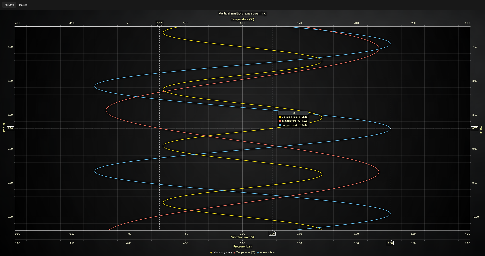

# LightningChart MAUI Example

This .NET MAUI example streams generated measurements vertically using three X value
axes and two Y time axes. Vibration uses the default bottom X axis and left Y axis. Temperature uses the top X axis and left Y axis. Pressure uses a second, parallel bottom X axis and the right Y axis. Both time axes scroll downward.

Learn more: [LightningChart documentation](https://lightningchart.com/lc-la/docs/)



## Prerequisites

- Windows 10 build 19041 or later
- .NET 10 SDK with the MAUI workload
- LightningChart JS license key ([get one here](https://lightningchart.com/js-charts/))

Install the MAUI workload if needed:
```powershell
dotnet workload install maui
```

## Build and Run

1. Clone the repository:
   ```powershell
   git clone https://github.com/Lightning-Chart/lc-la.git
   cd lc-la
   ```

   If you already have the repository, open a terminal in its root folder.

2. Install dependencies:
   ```powershell
   npm install
   ```

3. Copy `.env.example` to `.env` in the repository root and set `LCJS_LICENSE_KEY` to your license key.

4. Start the Windows example:
   ```powershell
   npm run dev
   ```

   Select ".NET MAUI", then "Multiple axes".

5. The app generates its demonstration data locally. **Start** begins generating measurements. **Pause** stops generation. **Resume** continues from the same timestamp position without clearing the chart.
