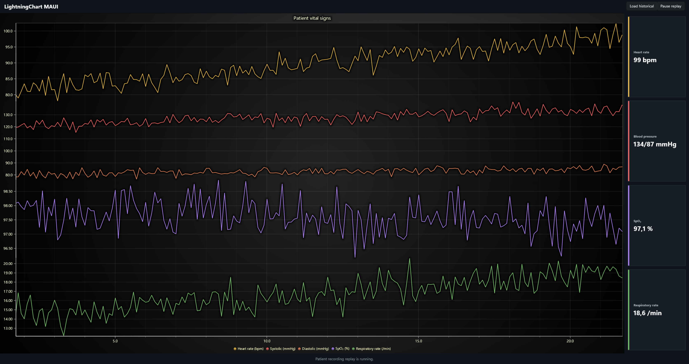

# LightningChart MAUI Example

This .NET MAUI example displays patient vital signs from `Data/patient_10.csv` in stacked chart sections. Systolic and diastolic share a blood-pressure axis. The recording can be viewed as historical data or replayed using its timestamps.

Learn more: [LightningChart documentation](https://lightningchart.com/lc-la/docs/)



## Prerequisites

- Windows 10 build 19041 or later
- .NET 10 SDK with the MAUI workload
- LightningChart JS license key ([get one here](https://lightningchart.com/js-charts/))

Install the MAUI workload if needed:
```powershell
dotnet workload install maui
```

## Build and Run

1. Clone the repository:
   ```powershell
   git clone https://github.com/Lightning-Chart/lc-la.git
   cd lc-la
   ```

   If you already have the repository, open a terminal in its root folder.

2. Install dependencies:
   ```powershell
   npm install
   ```

3. Copy `.env.example` to `.env` in the repository root and set `LCJS_LICENSE_KEY` to your license key.

4. Start the Windows example:
   ```powershell
   npm run dev
   ```

   Select ".NET MAUI", then "Patient vital signs".

5. The app initially loads the historical recording. Select **Start replay** to replay the measurements. 
Select **Pause replay**, then **Resume replay**, to pause and continue. 
Select **Load historical** to stop replay and display the historical recording.