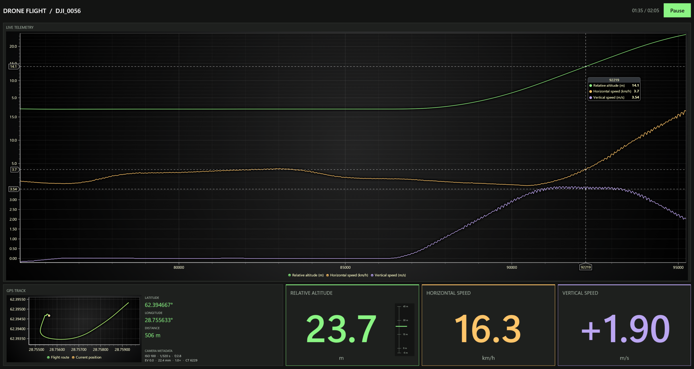

# LightningChart Uno Platform Example

This Uno Platform example replays a drone flight from `Data/drone_data_timestamp_added.CSV`. Two WebViews display the charts: a telemetry chart shows altitude, horizontal speed, and vertical speed, and a route chart shows the flight path reached so far and the drone's current position. The KPI cards display the current measurements, GPS coordinates, distance, and camera metadata.

Learn more: [LightningChart documentation](https://lightningchart.com/lc-la/docs/)



## Prerequisites

- Windows 10 build 19041 or later
- .NET 10 SDK
- Microsoft Edge WebView2 Runtime, normally already installed on Windows
- LightningChart JS license key ([get one here](https://lightningchart.com/js-charts/))

## Build and Run

1. Clone the repository:
   ```powershell
   git clone https://github.com/Lightning-Chart/lc-la.git
   cd lc-la
   ```
   If you already have the repository, open a terminal in its root folder.

2. Install dependencies:
   ```powershell
   npm install
   ```

3. Copy `.env.example` to `.env` in the repository root and set `LCJS_LICENSE_KEY` to your license key.

4. Start the Windows example:
   ```powershell
   npm run dev
   ```

   Select "Uno Platform", then "Drone flight dashboard".

5. Playback starts automatically after both charts initialize. Select **Pause**
to pause, then **Play** to resume.